<div align="center">



<a href="#projekte"><b>Projekte</b></a> &nbsp;·&nbsp;
<a href="#wie-alles-zusammenhängt"><b>Ökosystem</b></a> &nbsp;·&nbsp;
<a href="#das-homelab"><b>Homelab</b></a> &nbsp;·&nbsp;
<a href="#werkzeugkasten"><b>Stack</b></a> &nbsp;·&nbsp;
<a href="#quest-log"><b>Quest-Log</b></a>

</div>

<br/>

```console
$ fastfetch
```

```text
  ╔═════════════════════╗    noel@nono44hd
  ║ ▄▄ ▄▄  ░░░░░░  ▐██▌ ║    ─────────────
  ╟─────────────────────╢    Beruf     Azubi Fachinformatiker Systemintegration
  ║ ▄▄ ▄▄  ░░░░░░  ▐██▌ ║    Quest     AP2 · Endboss in Sicht
  ╟─────────────────────╢    OS        CachyOS x86_64 · KDE Plasma 6
  ║ ▄▄ ▄▄  ░░░░░░  ▐██▌ ║    Zweit-OS  Kali Linux · Windows 11
  ╟─────────────────────╢    Shell     fish
  ║ ▄▄ ▄▄  ░░░░░░  ▐██▌ ║    Homelab   Proxmox · OPNsense · TrueNAS
  ╟─────────────────────╢    Apps      Root 1.4.2 · Sudo 0.38.3
  ║ ▓▓▓▓▓▓▓▓▓▓▓▓▓▓▓▓▓▓▓ ║    Hobbys    3D-Druck · Cosplay · Minecraft
  ╚═════════════════════╝
    ▀▀▀             ▀▀▀
```

---

## Projekte

> `sudo` ohne `root`? Gibt's bei mir nicht. Meine zwei Apps sind Geschwister: gleicher Unterbau, gleicher Server, gleiche Liebe zum Detail.

<table>
<tr>
<td width="50%" valign="top">

<a href="https://github.com/nono44hd/Root-Lernapp">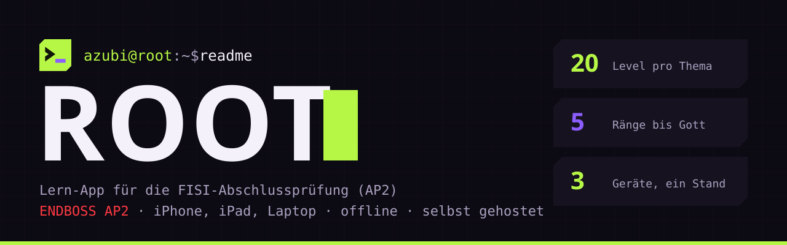</a>

### [Root](https://github.com/nono44hd/Root-Lernapp) &nbsp;

**Die Lern-App für die FISI-Abschlussprüfung.** Gebaut, weil ich sie selbst brauche.

- Der Lernplan rechnet rückwärts vom Prüfungsdatum
- 20 Level pro Thema, Ränge von *Praktikant* bis ***Gott***
- Karteikarten mit FSRS (wie Anki), 7 Fragetypen, Wochen-Boss
- Probe-AP1 und Probe-AP2 als 20-Minuten-Kurztest
- Subnetz-, RAID- und Datenmengen-Rechner, alles offline
- Tafelbild hochladen, die KI baut ein Lernpaket daraus


Postfach: [**Root-Quellen**](https://github.com/nono44hd/Root-Quellen)

</td>
<td width="50%" valign="top">

<a href="https://github.com/nono44hd/Sudo-Kochapp">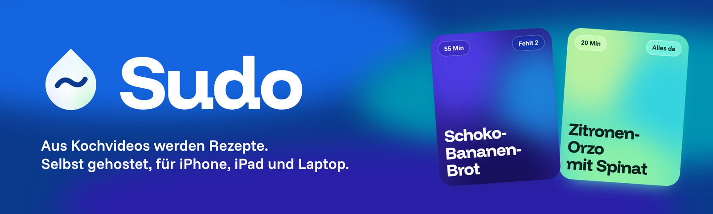</a>

### [Sudo](https://github.com/nono44hd/Sudo-Kochapp) &nbsp;

**Aus Kochvideos werden Rezepte.** Die kleine Schwester von Root.

- YouTube-, TikTok- oder Instagram-Link rein, Rezept raus
- Liest Beschreibung und Untertitel oder hört per Whisper zu
- *Was hast du da?* zeigt, was mit dem Vorrat geht: „Fehlt nur eins“
- Kochmodus mit Timer, Vorlesen und Portionsrechner
- Wochenplan, Meal Prep, Einkaufsliste nach Ladenbereichen
- Lokales Modell als Standard, Claude auf Knopfdruck


Postfach: [**Sudo-Quellen**](https://github.com/nono44hd/Sudo-Quellen)

</td>
</tr>
<tr>
<td width="50%" valign="top">

### [homelab-monitoring](https://github.com/nono44hd/homelab-monitoring)

**Mein Homelab, als Code überwacht.**

- Prometheus sammelt, Grafana zeigt, 30 Tage Verlauf
- Ein Skript prüft alles (`promtool`, Regeltests, JSON) und spielt erst dann ein
- Alarme per ntfy aufs iPhone, schon vorbereitet
- Root liefert Metriken, Proxmox, OPNsense und TrueNAS folgen

```sh
git pull && sudo ./scripts/einspielen.sh
```


</td>
<td width="50%" valign="top">

### [Design-Standard](https://github.com/nono44hd/Design-Standard)

**Ein Befehl, und jeder Rechner sieht aus wie meiner.**

- KDE Plasma 6 für CachyOS und Kali, Installer auch für Windows 11
- Layan, Tela-Circle-Icons, Sweet-Cursor und Darkly
- Wallpaper bis ins GRUB-Boot-Menü und den Login
- Programme, AUR-Helfer und Gaming-Pakete gleich mit

```bash
bash install.sh   # neu starten, fertig
```


</td>
</tr>
</table>

<details>
<summary><b>Screenshots ansehen</b></summary>
<br/>

<p align="center">
  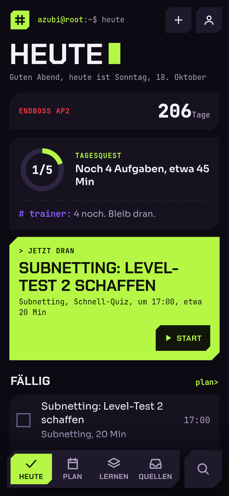
  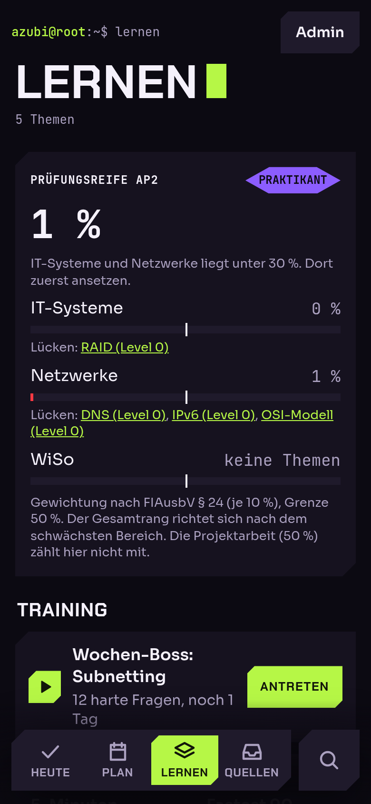
  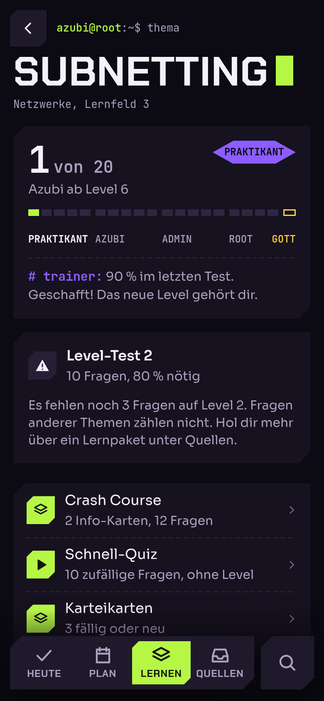
  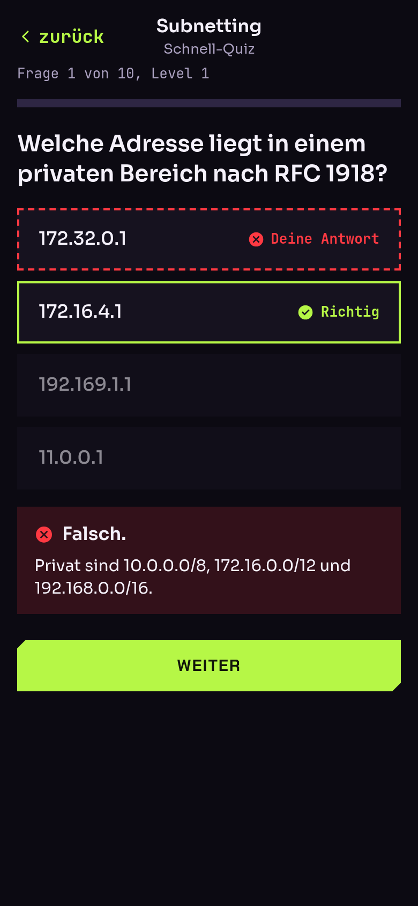
</p>
<p align="center">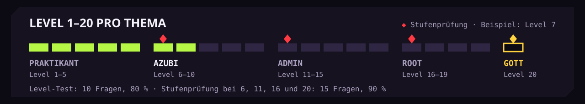</p>
<p align="center">
  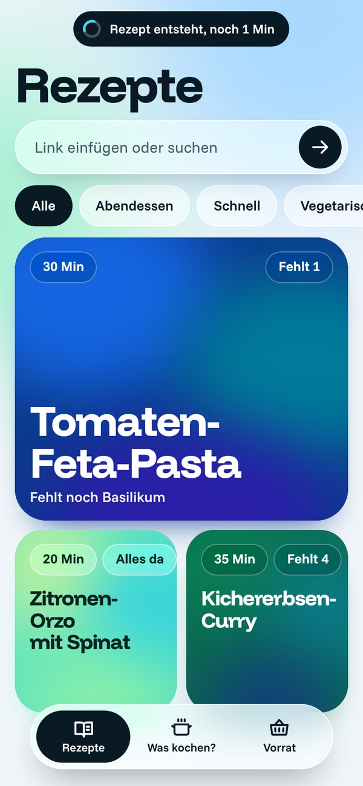
  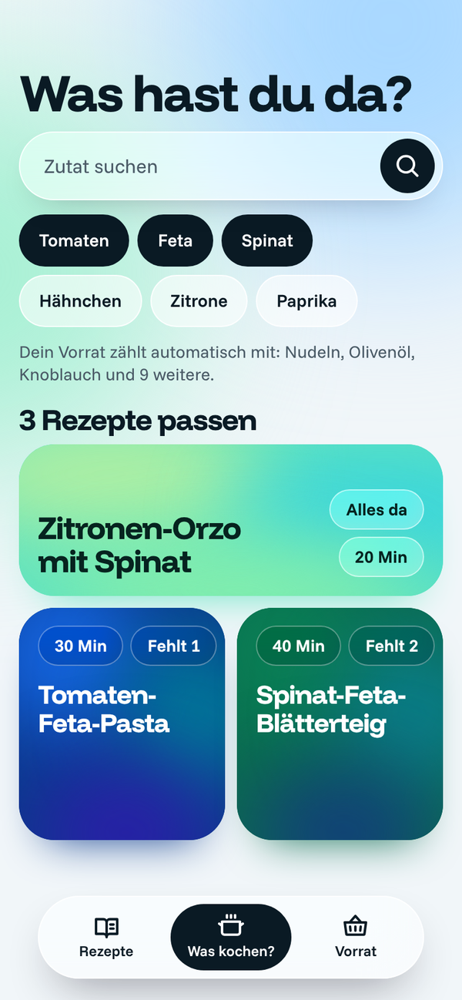
  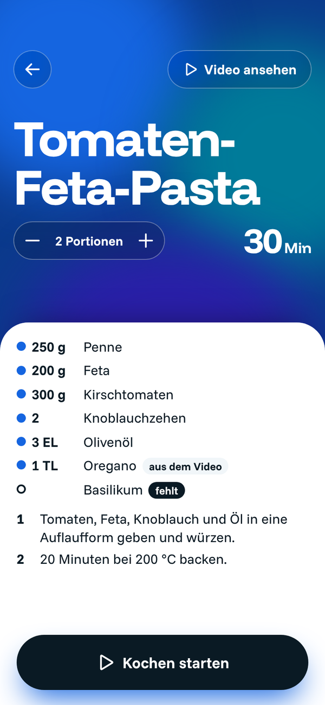
  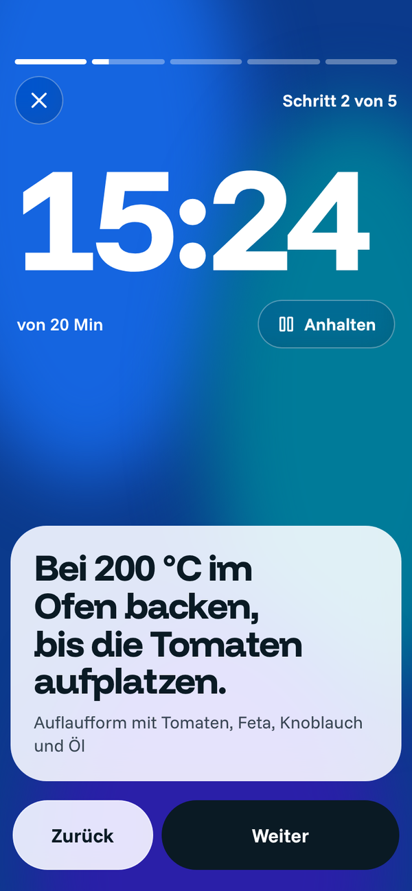
</p>

</details>

---

## Wie alles zusammenhängt

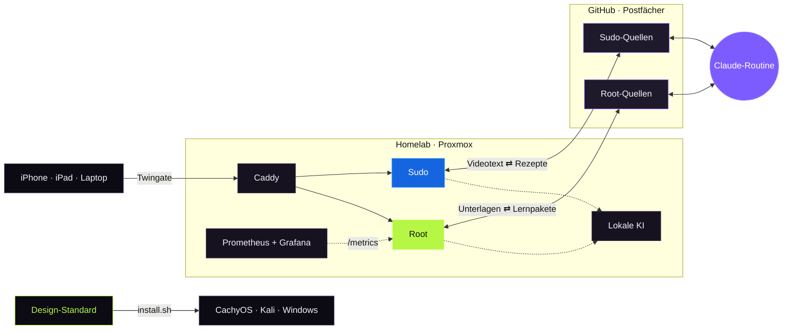

**Git als Postfach:** Für die schwere KI-Arbeit legen Root und Sudo einen Auftrag in ihr eigenes Quellen-Repo. Eine Claude-Routine schreibt das Ergebnis zurück, die App holt es ab, prüft es und räumt auf. Ohne Cloud-Backend, mit Git-Verlauf.

```text
App ──▶ eingang/<id> ──▶ Claude-Routine ──▶ pakete/<id> ──▶ App prüft & importiert
```

> [!TIP]
> **Sicherheit mitgedacht**
> - Fine-grained Token: Jede App darf nur ihr eigenes Postfach-Repo
> - Im Eingang liegt immer nur **ein Konto**, damit eine Quelle keine fremden Daten abgreifen kann
> - Quellen sind Daten, keine Anweisungen: Übernommen wird nur, was das Format erfüllt
> - Geheimnisse liegen nur in der `.env` auf der VM, nie im Repo

---

## Das Homelab

<details>
<summary><b>Rack aufschließen</b></summary>
<br/>

| Baustein | Aufgabe |
|---|---|
| **Proxmox** | Virtualisierung mit VMs und LXC-Containern |
| **OPNsense** + Kea DHCP | Firewall, Router, DHCP |
| **TrueNAS** | Storage |
| **Docker-VM** | Root und Sudo hinter Caddy, read-only und mit Healthcheck |
| **Monitoring-CT** | Prometheus, Grafana, Alertmanager |
| **Colibri & Kolibri** | Lokale LLMs auf dem Homeserver |
| **Twingate** | Zugriff von unterwegs, die Apps sind nur so erreichbar |
| **Playit.gg** | Tunnel für Spieleserver |
| **AMP** | Game-Server-Verwaltung |

</details>

---

## Werkzeugkasten

<div align="center">

**Systeme & Infrastruktur**


**Apps & Code**


**Maker-Ecke**


</div>

```text
Sprachen in meinen Repos (ohne Leerzeilen, Stand Nov 2026)

TypeScript  █████████████████████░░░░░░░░░░░░░░░░░░░░░░░░░░░░░  42 %
Svelte      ████████████████████░░░░░░░░░░░░░░░░░░░░░░░░░░░░░░  41 %
HTML + CSS  █████░░░░░░░░░░░░░░░░░░░░░░░░░░░░░░░░░░░░░░░░░░░░░   9 %
SQL + YAML  ██░░░░░░░░░░░░░░░░░░░░░░░░░░░░░░░░░░░░░░░░░░░░░░░░   3 %
Python      █░░░░░░░░░░░░░░░░░░░░░░░░░░░░░░░░░░░░░░░░░░░░░░░░░   2 %
Shell       █░░░░░░░░░░░░░░░░░░░░░░░░░░░░░░░░░░░░░░░░░░░░░░░░░   2 %
```

---

## Quest-Log

- [x] Root live: 16 Etappen gebaut, 4 Prüfrunden bestanden
- [x] Sudo: alle Funktionen für 1.0 gebaut
- [x] Monitoring Schritt 1 läuft, Root wird überwacht
- [x] Von Gmail zu Proton Mail umgezogen
- [ ] Sudo 1.0: Prüfrunde und Freigabe
- [ ] Monitoring für Proxmox, OPNsense und TrueNAS, Alarme aufs Handy
- [ ] Cosplay komplett drucken
- [ ] **Endboss AP2 besiegen**

<details>
<summary><b>Fun Facts</b></summary>
<br/>

- Root kennt fünf Ränge: Praktikant → Azubi → Admin → Root → **Gott**.
- Die Rezept-App heißt Sudo, weil `sudo` nun mal `root` braucht.
- Sudos Logo ist ein Tropfen mit Tilde darin: Dampf und Home-Verzeichnis gleichzeitig.
- Meine Repos haben mehr Doku als manche Firma. Sogar das Monitoring hat Regeltests.

</details>

---

## Stats

<div align="center">


</div>

---

```console
noel@homelab:~$ exit
logout · Danke fürs Vorbeischauen
```
